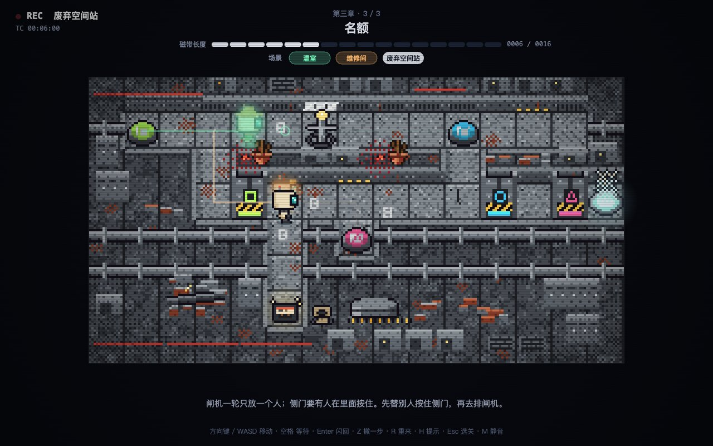
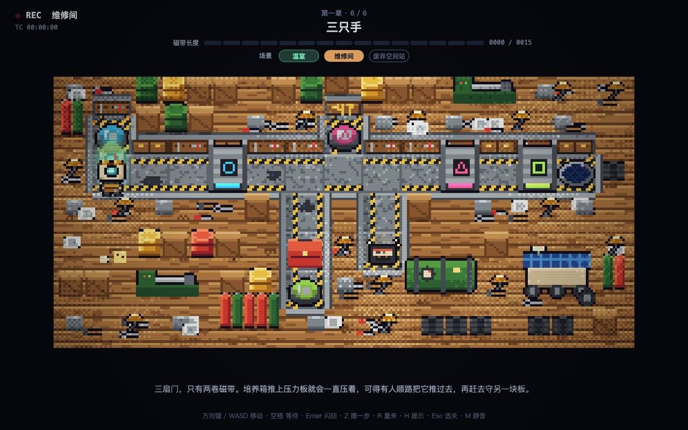
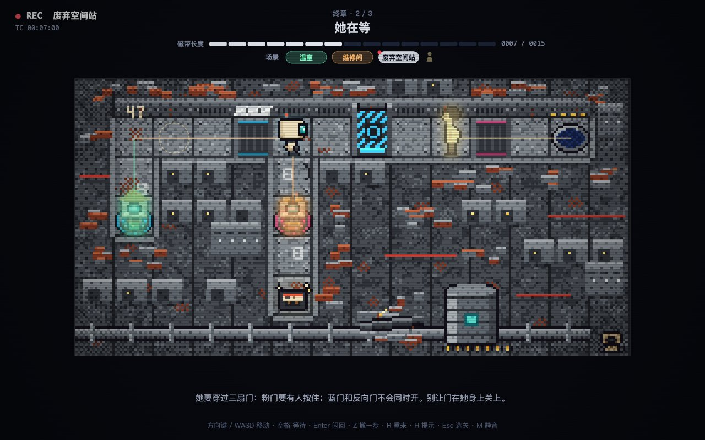
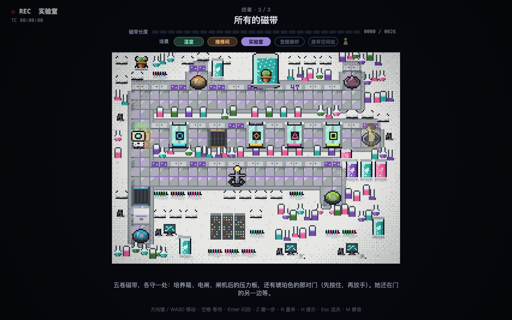

# 第 47 号磁带 · TAPE 47

> **有些门，一个人打不开。所以你得先变成好几个人。**

一个像素风的时间回溯解谜游戏。回声中继站已经空了 4017 天，维修单元 47 醒来时，核心舱传来断断续续的信号：「……开……门……」。可站里每一扇门都要两个人才能打开，而站里只剩下它。

于是 47 把自己录进磁带：在温室里走一遍，倒带，到维修间再走一遍——刚才的自己会变成虚影，把每一步原样重放，替现在的你踩住压力板、推开培养箱、按住那扇门。

  
  

  
  

**下载 `echo.html`，用浏览器打开就能玩。** 不用安装，没有依赖，离线可玩，手机也行。

## 为什么值得一玩

- **一个人的合作游戏**：每卷磁带都是一个你。三个场景，就是三个你在同一条时间线上配合；一步走错，过去的自己就会被门夹住。
- **23 关，难度一路往上走**：前几关教你「站上去、按住门」，后面要一个分身身兼数职、在 3 步的电闸窗口里卡点、让反向门在对的那一刻关上。
- **每关都算过最少步数**：用求解器穷举出每关的最短磁带，按你用的步数给 1～3 颗星。通关之后，回来拿满 ★69 吧。
- **卡住了不用关网页**：按 H 先看「谁该做什么」，再按一次，路线直接画在地上。
- **五个时空，五套像素世界**：温室、维修间、实验室、登舰廊桥、废弃空间站，每个场景的地图、机关和 47 的服装都不一样，全部由代码逐像素绘制。
- **一个关于等待的故事**：每一章是 47 磁带里的一段记忆，从撤离前 214 天一路放到撤离当天。每通过一关，就恢复一段船员当年的录音，慢慢拼出 4017 天前发生了什么：许遥为什么留下，那台让 47 能「带上昨天的自己」的磁带机是谁造的，「开门」这个信号又是谁发出的。终章里，她的影像会一边朝你走来一边跟你说话。
- **藏起来的许遥日志**：很多关卡的角落里有一条死胡同，尽头放着一盒发光的旧磁带。现在的你来不及去捡，得让某个过去的你挤出时间绕一趟。带着它通关，就能听到许遥自己的日志——那是主线录音里没说出口的一层。全部找齐，结局会在门开之后继续。
- **存档、选关、手机触屏、色盲友好**（每种颜色的机关都带形状记号），进度自动保存在浏览器里。

## 宣传短片 · Trailer

**官方宣传视频 · 61 秒**：时间回溯解谜、五大场景时空协作，以及第 47 号磁带的故事。

https://github.com/user-attachments/assets/1e4aa4e3-6973-4ae8-bd25-6f004d392f57

点击播放器即可观看完整宣传片（720p）。

## 运行

不用构建，也没有依赖。用浏览器直接打开 `echo.html` 就能玩（约 8.9 MB，序幕、尾声短片、像素美术引擎与五大场景环境音乐都在这一个文件里）。

想发链接给朋友玩：在仓库的 Settings → Pages 里选择从 `main` 分支根目录发布，仓库里的 `index.html` 会自动跳到游戏，手机打开链接就能玩。进度保存在各自的浏览器里。

## 操作

| 键盘 | 手机 | 作用 |
| --- | --- | --- |
| 方向键 / WASD | 方向键按钮或在地图上滑动 | 移动 |
| 空格 | 等待 | 原地等一步 |
| Enter | 闪回 | 倒带，到下一个场景录下一卷 |
| Z | 撤一步 | 撤回一步（在场景开头会退回上一个场景） |
| R | 重来 | 重来本关 |
| H | 提示 | 第一次：分工提示；第二次：在地上画出本场景路线（本关最多两颗星） |
| Esc / L | 选关 | 打开选关页 |
| M | — | 静音 / 恢复声音 |

标题页会显示「继续」，从你上次到达的关卡接着玩；已解锁的关卡都可以在选关页随时重玩，刷新最好成绩。

## 玩法：场景闪回

一关需要几个人协作，就有几个场景，每个场景里都是不同时空的 47。

- 场景顺序固定为：温室 → 维修间 → 实验室 → 登舰廊桥 → 废弃空间站。一关有 n 个人时，取前 n−1 个场景，最后一个人固定在废弃空间站。例如三人关依次是温室、维修间、废弃空间站。
- 所有场景布局相同，机关一一对应、功能一致：温室里的浇水阀，就是维修间的工具台踏板，也是废弃空间站的压力板。
- 每个场景只有十几步（看上方的磁带长度）。按 Enter 闪回到下一个场景，之前场景里的 47 会以虚影的形式同时行动，它们踩下的机关在当前场景同样生效。
- 出口只在废弃空间站开放。
- 如果一步会让之前场景里的自己被门夹住，游戏会拦下这一步，并告诉你原因。

| 机关 | 温室 | 维修间 | 实验室 | 登舰廊桥 | 废弃空间站 |
| --- | --- | --- | --- | --- | --- |
| 压力板 | 浇水阀 | 工具台踏板 | 样本台 | 登舰踏板 | 压力板 |
| 门 | 隔门 | 卷帘门 | 气密门 | 舱门 | 门 |
| 可推物 | 花盆推车 | 工具箱 | 样本柜 | 行李箱 | 培养箱 |
| 定时开关 | 定时喷淋 | 电焊闸 | 离心机开关 | 广播按钮 | 过载电闸 |
| 单人闸机 | 单人栅门 | 单人闸口 | 消毒闸 | 检票闸机 | 单人闸机 |

每个场景有自己的像素地图、机关外观和 47 的服装，全部由 `echo.html` 里的代码现场绘制。

## 章节

序章、五个章节和尾声，共二十三关。每通过一关，会恢复一段船员当年的录音，并按用掉的磁带长度给出 1～3 颗星（每关的最少步数都由求解器穷举得出）。

| 章节 | 关卡 |
| --- | --- |
| 序章 | 唤醒 |
| 第一章 | 双人门禁 · 接力 · 培养箱 · 两只培养箱 · 借来的培养箱 · 三只手 |
| 第二章 | 一机两用 · 过载电闸 · 错峰 · 三秒 · 连闸 |
| 第三章 | 单人闸机 · 撤离名单 · 名额 |
| 第四章 | 卡带 · 反锁 · 三卷磁带 · 漏气 |
| 终章 | 门那边的人 · 她在等 · 所有的磁带 |
| 尾声 | 第 47 号磁带 |

难度逐章递增：每章先用一两关介绍新机关，再用组合关收尾。前几关的磁带长度比最短解多 2–3 步，越往后余量越少，每章收尾关只多 1 步；后半程的关卡都不能靠「每个分身各踩一块板站着不动」通过，需要同一个分身先后承担几件事，或者掐准时间。

> 有些门，一个人打不开。所以总有人，替你按住它。

## 序幕与尾声 · 两段 HD-2D 短片

- **序幕（18 秒）**：在标题画面点击「接收信号」或按 Enter 播放。回声中继站静默多年，47 在黑暗里醒来，听见「……开……门……」；随后五个场景的自己依次亮起，一起把门打开。播完直接进入序章。
- **尾声（15 秒）**：通关最后一关、读完三页尾声文字后自动播放。救生舱里，磁带机放出许遥最后的录音「外面很大吧。替我多看看。」；舱在日出时落到地球的原野上，47 走到小屋前敲门，门开了。播完进入片尾磁带画面。

播放时：空格暂停 / 继续，Enter 或 Esc 跳过，M 静音，右下角是进度。

两段视频都是 720p H.264（合计约 4 MB），和标题画面背景一起内嵌在 `echo.html` 中。单个 HTML 离线也能播放，不需要本地服务。短片制作与素材致谢见 [CREDITS.md](CREDITS.md)。

## 许遥的影像

终章和尾声里那个沿着路走来的金色影像就是许遥，游戏里唯一的人。她有正面、朝左、朝右、背面四个朝向，游戏按她的移动方向切换。

影像呈琥珀色并半透明，叠加扫描线、扫过的光带和偶尔的信号抖动。告别时她转向 47，轻轻挥手，然后慢慢淡出。

## 像素美术

关卡画面全部是代码绘制的 16-bit 像素画：每格 16×16 像素，五个场景共用一套限定色板，按整数倍放大显示，不做平滑。

- **地图直接来自关卡格子**：地面、墙顶和墙的正面（经典俯视 RPG 的 3/4 视角）都按关卡地图逐格绘制，路径和玩法格子永远对齐，新增关卡也会自动生成完整画面。
- **五个场景各有一套材质和摆设**：
  - 温室：赤陶砖路，种着番茄、生菜、向日葵的种植床，池塘、果树和育苗箱；
  - 维修间：水泥地和警示胶带，工作台、油桶、车床和修了一半的探测车；
  - 实验室：瓷砖地，实验台、发光样本罐和大培养舱；
  - 登舰廊桥：金属格栅地板，指向出口的引导箭头，控制台、座椅，以及望向地球的舷窗；
  - 废弃空间站：铆钉钢板地，锈迹、管线、储物柜和坍塌的设备。
- **机关按场景换外观**：门有木栅门、卷帘门、玻璃气密门、舱门、防爆门五种；培养箱在各场景分别是菜推车、工具箱、样本柜、行李箱、培养舱。颜色关系在所有场景中保持一致。
- **47 和许遥**也是像素形象：47 有前、后、左、右四个朝向，五个场景各一套服装；许遥的影像由游戏染成琥珀色的全息投影。
- **藏在地图里的细节**：每个场景都有一处「47」字样；第一章的那颗番茄会一关比一关红；空间站的墙上刻着计数划痕，角落里躺着 47 的前一台维修单元。

## 五大场景专属环境音乐 · Ambient BGM

每个场景拥有独立的专属环境音乐（BGM），配合各场景的像素地图与场景道具，营造不同时空的沉浸式氛围：

- **温室 (`greenhouse`)**：空灵温暖的空气流动感与轻柔水滴泛音，烘托最初苏醒时的安宁与未知。
- **维修间 (`workshop`)**：微弱的工业底噪、金属谐振与机械阻尼感，传递坚实专注的作业质感。
- **实验室 (`lab`)**：高频晶体共振与冷调电子脉冲，契合严密精密的科学仪器与样本分析意境。
- **登舰廊桥 (`bridge`)**：深邃的星际空间回响与悬浮声景，营造登舰前夕的苍凉与期待。
- **废弃空间站 (`station`)**：极低频次声波 Drone、孤独的心跳残响与空间寂寥，将时间回溯的叙事张力推至顶点。

### 混音与交互机制

- **平滑交叉混音（Crossfade）**：在场景闪回、倒带或切换时，新旧场景音乐在主循环中逐帧平滑淡入淡出（约 0.25 秒缓冲），消除波形断裂与点击爆破音。
- **情境智能调度**：在序幕与尾声短片、片头封面、告别停带瞬间（`tapeStop`）及通关结算画面自动静音或淡出，与原声短片及剧情音效和谐共存。
- **静音快捷切换**：随时按 `M` 键或点击声音控制，关卡游玩时屏幕即时弹出横幅提示（`静音` / `声音开启`），解禁时音量柔和恢复。

## 仓库内容

- [`echo.html`](echo.html)：完整游戏，包含代码、关卡、美术、短片和音乐。
- [`README.md`](README.md)：运行方式、操作与玩法说明。
- [`CREDITS.md`](CREDITS.md)：短片制作与素材致谢。

原始素材、制作脚本、预览输出与设计文档已从当前版本移除，需要重新制作素材时可从 Git 历史恢复。README 中的宣传片由 GitHub 附件托管，独立于游戏文件。
